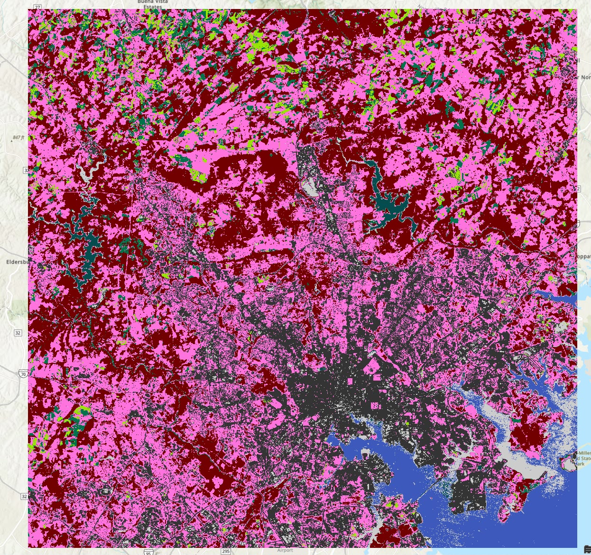
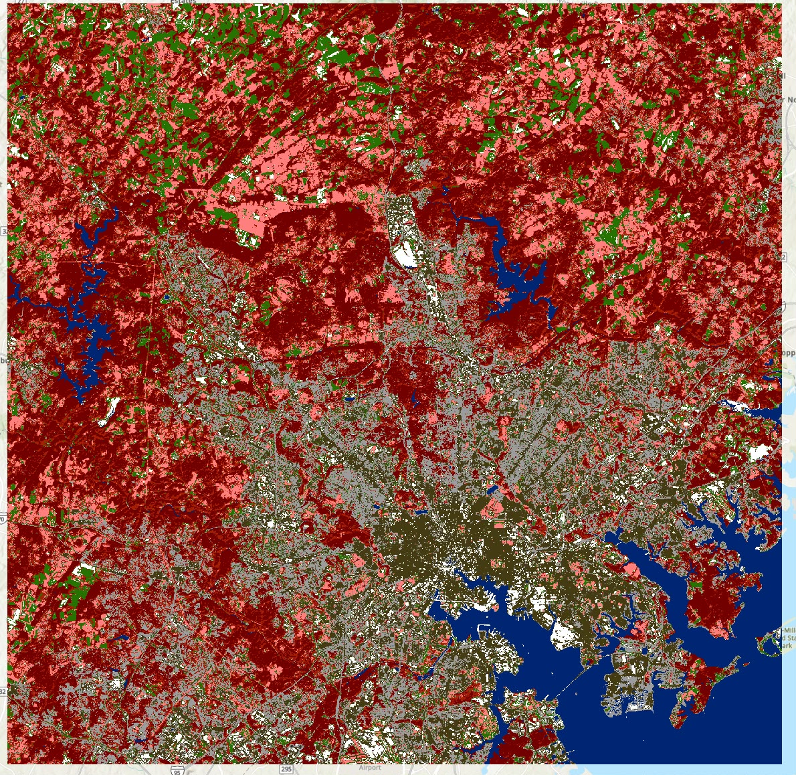

# Lab 4 - Classification

Name: Kris Su 

Date: 2026 Oct

## Question 1
### Copy your dendrogram onto your answer sheet (probably doing it as a picture rather than text will be easiest). Which two classes are most similar in your image? Does this make sense?

From dendrogram, the features that are most similar to each other are Dark Industrial/Urban and Bright Industrial/Urban. This makes sense, in the map, the bright urban patches are usually found surrounded by darker urban patches, and these bright urban features usually takes up less pixel.

```text
C   DISTANCE
L
A
S  0       2.7     5.5     8.2    11.0    13.7    16.4    19.2    21.9    24.7
S  |-------|-------|-------|-------|-------|-------|-------|-------|-------|

  8 -------------|
                 |-|
  7 -------------| |---------------|
                   |               |
  6 ---------------|               |
                                   |---------------------------------------|
  5 ---------------------|         |                                       |
                         |---|     |                                       |
  4 ---------------------|   |-----|                                       |
                             |                                             |-
  3 -------------------------|                                             |
                                                                           |
  2 -------------------------------------------|                           |
                                               |---------------------------|
  1 -------------------------------------------|

   |-------|-------|-------|-------|-------|-------|-------|-------|-------|
   0       2.7     5.5     8.2    11.0    13.7    16.4    19.2    21.9    24.7

```
## Question 2
<!-- : Pan around your classified image, how did you do? Are there any obvious errors (e.g., water bodies that have been classified as “pink fields”)?  -->

<!-- If there are systematic errors, can you explain them based on the reflectance properties of the classes in which errors occurred? -->

In the results of my supervised classification, parts of the Back River and the shallow part of the water reservoir is classified as bright urban building. It appears, that the ArcGIS classifier have issue distinguishing bright urban signatures from other classes. This could be due to that 


## Question 3: What are “Maroon Vegetation,” “Pink Fields,” “Dark Green Vegetation,” and “Bright Green Fields”?

<!-- Symbology to assign Layer 4 to the red display channel, Layer 3 to green, and Layer 2 to blue: a 432-RGB combination. This Landsat TM image was acquired on October 19, 2009. -->

Layer 2 [visible green] are assigned to blue
Layer 3 [visible red] are assigned to green
Layer 4 [NIR ] are assigned to red

The `maroon vegetation` are trees and forested areas.

`Pink fields` are lawn.

`Dark green patches` are farmed land

`Bright green patches` are unfarmed land

## Question 4: 
<!-- This is an October image. Have the trees lost their leaves yet? How does this impact your ability to classify the image? Are there some land cover details that might be easier to detect in a different season? [You might want to add P15R3320100123.img, a winter image, to your Map Document when considering these questions] -->
The tree have not lost their leaves by the time this picture was taken. There is still considerable amount of NIR signal sensed in the image, suggesting presences of chlorophyll in the canopy cover.

as shown in the winter image, when tree looses their leaves they would appear brown/dark green in the 432 bands; maroon area turning brown/green.


## Question 5: 

The area of each class in the supervised classification,

|Class value| COUNT |AREA (m^2)|
|----------|-------|----------|
|Dark water|15478|13930200|
|Bright water|119235|107311500|
|Maroon vegetation|743252|668926800|
|Pink field|1028605|925744500|
|Dark green|112671|101403900|
|Bright green|60875|54787500|
|Bright industrial|97133|87419700|
|Dark urban|515407|463866300|


## Question 6: Compare your class areas with those of another student. 
>[!INFO]
> If there are systematic differences between the classifications, can the two of you explain them on the basis of the training regions that you created for each class?

## Question 7: 
<!-- Comment on the similarities and differences between your Supervised and Unsupervised Images. Is either one superior than the other for particular classes? [Note: you can dig into the details using Spatial Analyst → Zonal → Tabulate Areas, but that’s optional] -->


The table below shows the overlapping square in supervised and unsupervised,

|Unsupervised Class ID| Supervised class Dark water | Bright water|Maroon vegetation| Pink field |Dark green|Bright green|Bright industrial|Dark urban|
|----------|-------|----------|-|-|-|-|-|-|
|0 (Grey)|0|0|73800|182429100|5841000|16200|909900|144669600|
|1|0|421200|900.|157500|149400|13696200|34586100|27820800|
|2|0|0|117733500|304529400|3105000|0|0|1800|
|3|13930200|106890300|794700|0|155700|0|50262300|4518900|
|4|0.|0|1018800|281655900|0|0|9900.|44100.|
|5|0|0.|549214200.|76924800.|29587500.|0.0|793800.|6217200.|
|6|0.|0.|90900.|78345000.|62925300.|41075100.|405900.|34381800.|
|7|0.|0.|0.|1702800.|0.|0.|451800.|246212100.|


The unsupervised classifier does not distinguishes subtle differences between variants of the same type of target, like the ones suggested in the project, for example dark and shallow water.

But it successfully categorizes all water into its own class, without spilling over into categorizing parts of river as `bright industrial` which is seen as a systematic error in the supervised classification. 


## Question 8: Include a screen capture of both your supervised and unsupervised classifications in the lab report

### Supervised classification


### Unsupervised classification


## Question 9:
### Overall accuracy

$$
\begin{gather}

    \text{Overall correct} = \frac{\text{Total correct}}{\text{ Total of pixels}} \\ 
    \text{Overall correct} = \frac{482}{\text{584}} \\
    \text{Overall correct} = 83\%
    
\end{gather}
$$

### Kappa Coefficient
Improvement over chance:

Total number of pixel:
$$
N = (92 + 14 + 4) + (2 + 42 +3 + 1) + (1 + 8 +55 +15) + (1 + 41 +2+6+1) + (2+11+75+9+2) + (2+1+5+4+141+3) + (1+4+36) = 584
$$

Diagonal sum:
$$
A =92 + 42 + 55 + 41 + 75 + 141 + 36 = 482
$$

Sum of (row times column):
$$
B = 96 \times 110 + 66 \times 48 + 65\times 79 + 57 \times 51 + 82 \times 99 + 176 \times 156 + 42 \times 41 = 59066
$$

Kappa:

$$
\begin{gather}
    K = \frac{N\times A - B}{N^2 - B}\\
    K = \frac{584 \times 482 - 59066}{584^2 - 59066} = 0.789
    
\end{gather}
$$

### User's & Producer's accuracy


- User: For each class: Correct pixels / # pixels placed in the class
- Producer For each class: Correct pixels / # pixels that should have been placed in the class

|Class |User accuracy|Producer's accuracy|
|--|-------------|-------------------|
|Water|92 / 110 = 83.6%| 92 / 96 = 95.8%|
|dense urban|42 / 48 = 87.5%|42 / 66 = 63.6%|
|mixed industrial|55 / 79 = 69.6%|55 / 65 = 84.6|
|coniferous forest|41 / 51 = 80.3%|41 / 57 = 71.9%|
|broadleaf forest|75 / 99 = 75.8%|75 / 82 = 91.4%|
|Suburban residential|141 / 156 = 90.4%|141 / 176 = 80.1%|
|Agriculture|36 / 41 = 87.8%|36 / 42 = 85.7%|

From the user (commission) perspective `dense urban` is causing the most problem.
From the producer (omission) perspective `mixed industrial ` is causing the most problem.
